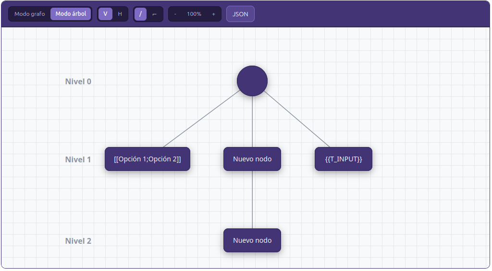
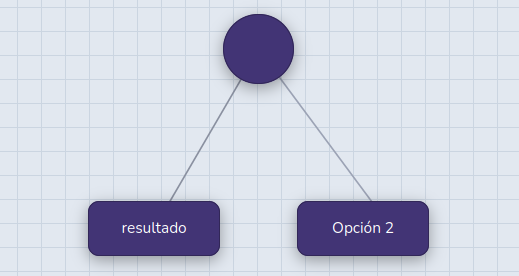

# Graph question type for Moodle (`qtype_graph`)

A Moodle question type where the teacher builds a node/edge diagram — a free-form **graph** or a
hierarchical **tree** — and the student answers by working on top of it: filling in blanks, picking
options from dropdowns, deleting nodes, and/or adding new connected nodes. Questions can be graded
automatically against one or more answer graphs, or left for manual grading.

Developed by [CMMEdu](https://github.com/cmmedu) for Rutas Digitales (Universidad de Chile).



## Features

- **Two layouts**: free-form graph, or tree (vertical/horizontal orientation, straight or orthogonal
  connection lines), with node shapes, colors, grid, background and per-level labels.
- **Blank types inside node, edge and leaf "floating label" text**:
  - `{{T_INPUT}}` — free-text input
  - `[[option 1;option 2;option 3]]` — dropdown
  - `{{F:numerator|denominator}}` — stacked fraction, where either side can be an input, a dropdown or
    fixed text
- **Student actions** (each enabled per question): add new nodes, delete original nodes, change tree
  orientation / line style / graph type, and download the graph as PNG or SVG. New nodes and connectors
  can be free text, a dropdown, or fixed text.
- **Automatic grading** against an *answer graph*, matched to the default graph by node/edge id, with
  partial credit. Supports any number of **alternate answer graphs** — the student gets the best score
  among them.
- **Any-order matching**: sibling nodes sharing the same blank can be answered in any permutation.
- **Flexible accepted answers** and **numeric validation** (see below), plus an authoring-time
  *Validate answer graph* check.
- **Manual grading fallback**: leave the answer graph empty and the question is graded manually.
- Backup/restore and privacy API support.
- UI in Spanish (`es`, `es_mx`) and English (`en`).

## Requirements

- Moodle **5.0** or later (`$plugin->requires = 2025041400`).
- Maturity: **alpha** (`0.1`).

## Installation

1. Copy (or clone) this repository into your Moodle codebase at `question/type/graph`:

   ```bash
   git clone https://github.com/cmmedu/moodle-plugin-graphsandtrees.git {moodleroot}/question/type/graph
   ```

2. Visit *Site administration → Notifications* (`admin/index.php`), or run:

   ```bash
   php admin/cli/upgrade.php
   ```

3. "Graph" now appears in the question type chooser.

## Authoring a question

The edit form has three canvases:

1. **Default graph** — what the student sees. Click a node or edge to edit its text, color and shape,
   add connected nodes, or delete it. Use **"Marcar como input"** to turn a label into a blank, or
   **"Marcar como fracción"** for a fraction.
2. **Answer graph** — the expected final graph. Start from a copy with **Reset to default graph**, then:
   - type the accepted answer on each node/edge that is a blank in the default graph;
   - delete any node/edge the student is expected to delete;
   - add any node the student is expected to add (it must connect to an existing node so it can be
     matched).

   Leave this canvas empty to grade the question manually.
3. **Alternate answer graphs** (optional) — more graphs that also count as correct.



### Accepted-answer syntax (answer graph)

| Answer field | Accepts |
|---|---|
| `Madrid` | exactly that text (case-insensitive, trimmed) |
| `{{Madrid;Barcelona}}` or `{{"Madrid";"Barcelona"}}` | any of the listed answers |
| `{{T_ANY}}` | any non-empty answer |
| `{{T_ANY_N_EMPTY}}` | anything, including an empty answer |
| `{{N:0.5}}` | a number equal to 0.5 (`0,5`, `1/2` and `2/4` also match) |
| `{{N:3.14:0.01}}` | a number with tolerance (3.13 – 3.15) |
| `{{N:1..2}}` | a number in an inclusive range |
| `{{N:*}}` | any number |
| `{{N:2;-2;5..6}}` | any of several numeric items |
| `3/4` / `{{N:3/4}}` | for a fraction blank: exactly `3/4` / any equivalent value |

If the default graph surrounds a blank with fixed text (e.g. `antes [[A;B]] después`), you can repeat
that text in the answer graph (`antes A después`); it is stripped before comparing.

Accepted answers live only in the answer graph and are never sent to the student's browser.

## Graph helper page

[`graphhelperpage/index.html`](graphhelperpage/index.html) is a standalone, outside-Moodle version of the
editor (with a student-view preview and illustrated instructions, in Spanish) that lets you build graph
JSON in the browser. Open it through a local HTTP server, e.g.:

```bash
cd graphhelperpage && python3 -m http.server 8000
```

## Development

- **JavaScript**: the editor lives in `amd/src/editor.js`. After editing it, rebuild from the Moodle root
  with `grunt amd`; `amd/build/editor.min.js` is generated and committed — don't edit it by hand.
- **`graphhelperpage/editor.js` is a manual copy** of `amd/src/editor.js` with a different module wrapper.
  Re-apply any logic change there too.
- **Grading** is in `classes/grading.php`; answer parsing in `classes/answer_matcher.php`. The JS and PHP
  versions of the blank/answer grammar must stay in sync.
- **Database changes**: update `db/install.xml`, add a step to `db/upgrade.php`, and bump
  `$plugin->version` in `version.php`.
- **Tests** (PHPUnit, run from a Moodle install with this plugin in place):

  ```bash
  php admin/tool/phpunit/cli/init.php
  vendor/bin/phpunit question/type/graph/tests/classes/
  ```

See [`CLAUDE.md`](CLAUDE.md) for a detailed architecture and design reference.

## License

MIT — see [LICENSE](LICENSE). © 2026 CMMEdu.
